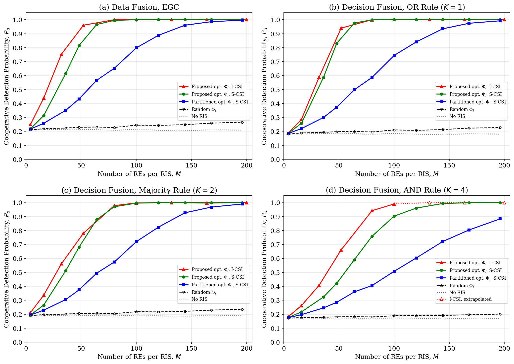
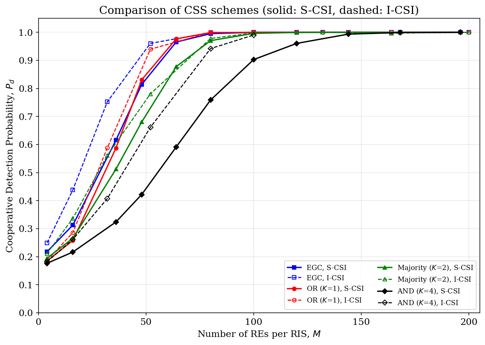
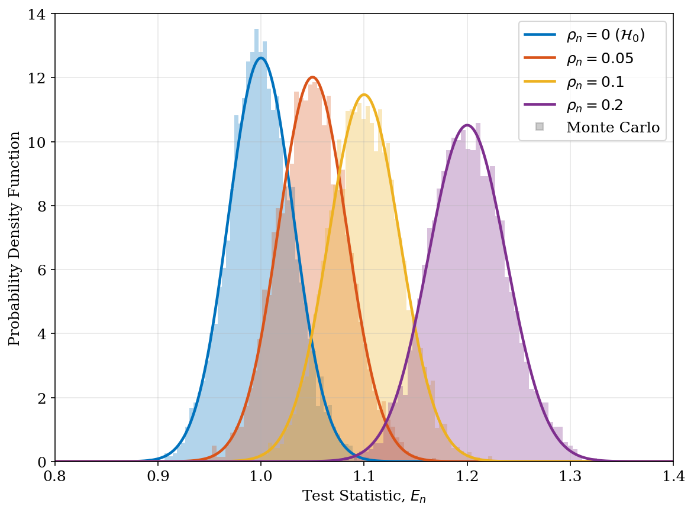
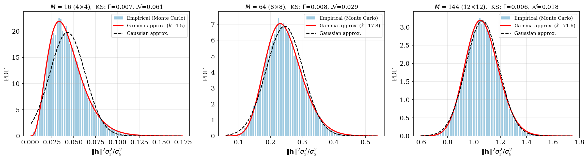
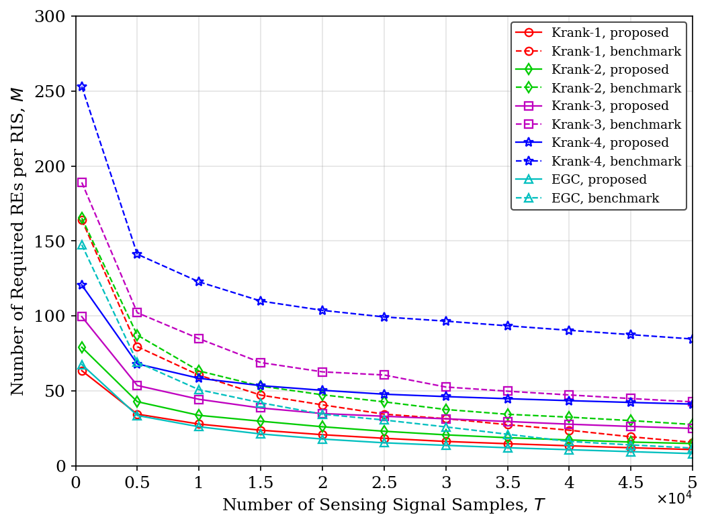
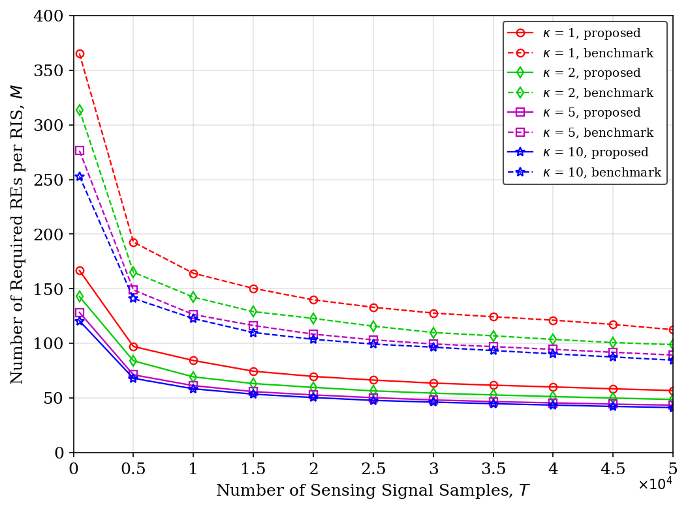
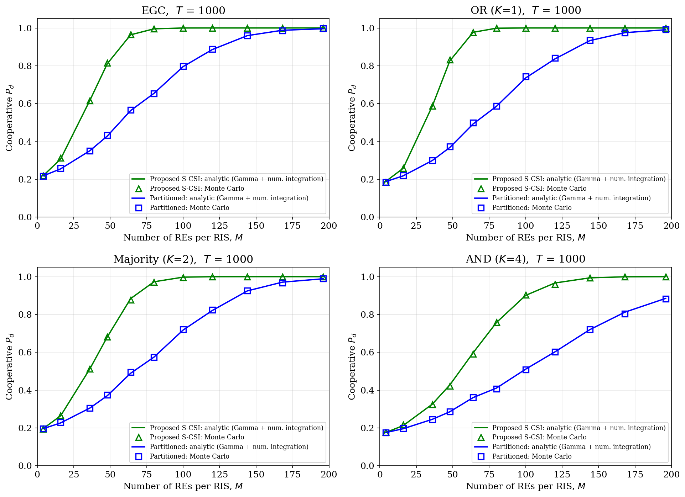

# RIS-Assisted Cooperative Spectrum Sensing for Cognitive Radio Networks


A Python implementation and reproduction of

> J. Ge, Y.-C. Liang, S. Wang, and C. Sun, **"RIS-Assisted Cooperative Spectrum Sensing for Cognitive Radio Networks,"** *IEEE Transactions on Wireless Communications*, vol. 23, no. 9, pp. 12547–12561, Sep. 2024.

Secondary users (SUs) in a cognitive radio network must detect a weak primary user (PU) before using its band. This project deploys **multiple reconfigurable intelligent surfaces (RISs)** to reflect the PU signal towards the SUs. It then **optimizes the RIS phase-shift matrices (PSMs)** for each cooperative spectrum sensing (CSS) scheme: EGC data fusion, and OR / Majority / AND decision fusion. The optimization is done with both **instantaneous** (I-CSI) and **statistical** (S-CSI) channel state information.

<p align="center">
  
  <br><em>Cooperative detection probability vs. number of reflecting elements (REs) per RIS, for all four CSS schemes.</em>
</p>

---

## Highlights

- **Full system model:** Rayleigh PU→SU, line-of-sight PU→RIS, Rician RIS→SU channels; CLT-based energy detection; EGC, OR, Majority (K-rank) and AND fusion.
- **PSM optimization (I-CSI and S-CSI):** semidefinite relaxation (SDR) with Gaussian randomization, as in the paper, combined with eigenvector, span-search and Gauss–Seidel candidates. Every candidate is scored on the true objective.
- **Number of REs for a target detection probability** (Section IV-C): Gamma approximation, numerical integration and bisection on *M*.
- **Validated:** the analytic detection probability matches an independent Monte-Carlo simulation to within **0.008**.
- **Reproduces the paper's Figs. 2, 3, 4, 5, 8 and 9**, with the same trends.

| Result | Value |
|---|---|
| Pd at M = 100, AND rule: I-CSI / S-CSI / partitioned / random | **0.99 / 0.90 / 0.51 / 0.19** |
| REs needed for P̄d = 0.9, AND rule, T = 1000: proposed vs partitioned | **100 vs 206 (2.1× fewer)** |
| RE saving over the partitioned benchmark, all schemes, T ≤ 5000 | **1.8× – 2.9×** |
| Gamma vs Gaussian fit of ‖h‖² (KS distance, M = 16) | **0.007 vs 0.061** |

---

## Results

### Comparison of CSS schemes (Fig. 5) · Test-statistic PDF (Fig. 2)

<p align="center">
  
  &nbsp;
  
</p>
<p align="center"><em>Left: Pd of each scheme under S-CSI (solid) and I-CSI (dashed). EGC is best at small M, and OR is best once M ≳ 40, as reported in the paper. Right: CLT model of the test statistic (lines) vs Monte Carlo (bars).</em></p>

### Gamma approximation of the channel gain (Fig. 3)

<p align="center">
  
  <br><em>Empirical PDF of ‖h‖² with the moment-matched Gamma (Proposition 3) and Gaussian approximations.</em>
</p>

### How many REs are needed? (Figs. 8 and 9)

<p align="center">
  
  &nbsp;
  
</p>
<p align="center"><em>Minimum REs per RIS for an average Pd of 0.9 vs the number of sensing samples T. Left: all schemes (solid = proposed, dashed = partitioned benchmark). Right: AND rule for Rician factors κ = 1, 2, 5, 10.</em></p>

### Analytic model vs Monte-Carlo simulation

<p align="center">
  
  <br><em>Lines: Gamma approximation with numerical integration (Eqs. 35, 46). Markers: Monte-Carlo simulation (10 SU drops × 100 fading draws per point).</em>
</p>

### Agreement with the paper

| Figure | Paper's observation | This implementation |
|---|---|---|
| Fig. 2 | Test statistic shifts right with ρₙ (CLT Gaussian) | Analytic curves match Monte Carlo |
| Fig. 3 | Gamma fits ‖h‖², Gaussian does not | KS 0.007 (Gamma) vs 0.061 (Gaussian) at M = 16 |
| Fig. 4 | I-CSI > S-CSI > partitioned > random | Same ordering for all four schemes |
| Fig. 5 | EGC best at small M; OR best for M ≳ 40 | EGC best at M = 16; OR 0.83 > EGC 0.81 at M = 48 |
| Fig. 8 | Required M falls with T; proposed ≪ benchmark; M grows with K | Same trends; 1.8–2.9× fewer REs |
| Fig. 9 | Higher κ → fewer REs, saturating | κ = 1 → 10: 167 → 121 REs (T = 500) |

Our S-CSI curves reach the target with roughly 10–20 % fewer REs than the published figures. The likely reasons are the stronger max-min solver and randomly drawn SU positions; the trends and conclusions are unchanged.

---

## Method

| Component | Implementation |
|---|---|
| Topology | PU at (0, 0); N = 4 SUs in a 10 m circle at (400, 0); L = 2 RISs at (380, 25) and (400, 25) |
| Channels | dₙ ~ CN(0, ηₙ); fₗ line-of-sight (UPA steering vectors); gₙ,ₗ Rician with κ = 10 |
| Detection | Energy detector, Eₙ ~ N(σᵤ² + ρₙσₛ², (σᵤ² + ρₙσₛ²)²/T); thresholds from P̄fa = 0.1 |
| Fusion | EGC (Prop. 1), OR / Majority / AND (K-rank, Table I) |
| I-CSI optimization | SDR + Gaussian randomization for AND; eigenvector + coordinate ascent for EGC; closed form for OR |
| S-CSI optimization | Same problems with gₙ → ḡₙ and dₙ = 0 (Eqs. 42–45); best of SDR / eigenvector / span search, refined by Gauss–Seidel |
| RE analysis | Gamma moment matching (Prop. 3), numerical integration (Eqs. 35, 46), bisection on M |

<details>
<summary><b>Simulation parameters</b> (Section V of the paper)</summary>

| Parameter | Value |
|---|---|
| Carrier wavelength λ | 0.12 m |
| PU transmit power / noise power | 30 dBm / −80 dBm |
| Path-loss exponents (PU–SU, PU–RIS, RIS–SU) | 3.5, 2, 2 |
| Rician factor κ | 10 |
| Sensing samples T | 1000 |
| Max. false-alarm probability | 0.1 |
| REs per RIS, M | 4 – 200 (near-square Mh × Mv arrays) |

</details>

---

## Repository structure

```
.
├── demo.py                  # End-to-end demo of the whole pipeline (< 1 min)
├── core/                    # Shared system model
│   ├── system_model.py      #   topology, parameters, path loss
│   ├── channel_model.py     #   Rayleigh / LOS / Rician channels, equivalent channel
│   ├── energy_detection.py  #   thresholds, Pd for EGC / AND / OR / K-rank
│   └── benchmark_psm.py     #   random and partitioned (benchmark) PSMs
├── icsi/                    # Instantaneous CSI
│   ├── proposed_psm_icsi.py #   I-CSI PSM optimizer (SDR)
│   ├── icsi_simulations.py  #   Pd vs M simulation
│   └── plot_from_logs.py    #   redraws the I-CSI figures from logged values
├── scsi/                    # Statistical CSI and RE analysis
│   ├── proposed_psm.py      #   S-CSI PSM optimizer
│   ├── scsi_simulations.py  #   Figs. 3, 4, 5
│   └── re_analysis.py       #   Figs. 8, 9 and analytic-vs-MC validation
├── plots/
│   ├── fig2_pdf_validation.py
│   └── combined_fig4.py     #   final Figs. 4 and 5 (I-CSI + S-CSI + benchmarks)
├── kaggle/                  # Notebook cells used for the long runs
├── results/                 # All figures and raw numbers (.npz / .json / .csv)
└── docs/                    # Final presentation (PDF)
```

---

## Getting started

```bash
git clone <this-repo-url>
cd <repo>
python -m pip install -r requirements.txt
python demo.py
```

`demo.py` runs the full pipeline on one SU drop and prints each stage:
- channels and false-alarm check: simulated Pfa ≈ 0.10;
- PSMs from every optimizer;
- cooperative Pd: No RIS 0.20 → partitioned 0.39 → proposed 0.97 (EGC, M = 64);
- Gamma moments;
- a bisection for the minimum M.

### Reproducing the figures

| Output | Command | Runtime |
|---|---|---|
| Fig. 4 / 5 (combined) from saved data | `python plots/combined_fig4.py` | ~3 s |
| Fig. 2 with Monte Carlo | `python plots/fig2_pdf_validation.py` | ~5 s |
| S-CSI Fig. 4 / 5 from saved data | `python scsi/scsi_simulations.py --plot` | ~3 s |
| Figs. 8 / 9 from saved data | `python scsi/re_analysis.py --plot` | ~3 s |
| S-CSI smoke test | `python scsi/scsi_simulations.py --quick` | ~2 min |
| RE-analysis smoke test | `python scsi/re_analysis.py --quick` | ~2 min |
| Full S-CSI run (Figs. 3–5) | `python scsi/scsi_simulations.py` | ~1–2 h (4 CPUs) |
| Full RE analysis (Figs. 8–9) | `python scsi/re_analysis.py` | ~30–40 min (4 CPUs) |

The full runs parallelize across CPU cores and save a checkpoint after every task, so an interrupted run resumes where it stopped. They were run on Kaggle CPU notebooks: upload the `core/` and `scsi/` files as a dataset and paste the matching cell from `kaggle/`.

---

## Notes and limitations

- The I-CSI AND-rule points for M ≥ 132 were not simulated because of compute limits. Pd is already 0.990 at M = 100 and increases with M; these points are drawn hollow in Fig. 4.
- The paper's Fig. 6 (cross-scheme PSMs) and Fig. 7 (single vs multiple RIS) are not reproduced.
- Array sizes are restricted to near-square Mh × Mv shapes, because very skewed arrays beam noticeably worse. In the RE analysis, the Pd = 0.9 crossing is interpolated between neighbouring allowed sizes.

## Authors

Pratham Shetty · Hrushikesh Sawant · Satyam Ambi

## Reference

```bibtex
@article{ge2024ris,
  author  = {Ge, Jungang and Liang, Ying-Chang and Wang, Shuo and Sun, Chen},
  title   = {{RIS}-Assisted Cooperative Spectrum Sensing for Cognitive Radio Networks},
  journal = {IEEE Transactions on Wireless Communications},
  volume  = {23},
  number  = {9},
  pages   = {12547--12561},
  year    = {2024}
}
```
